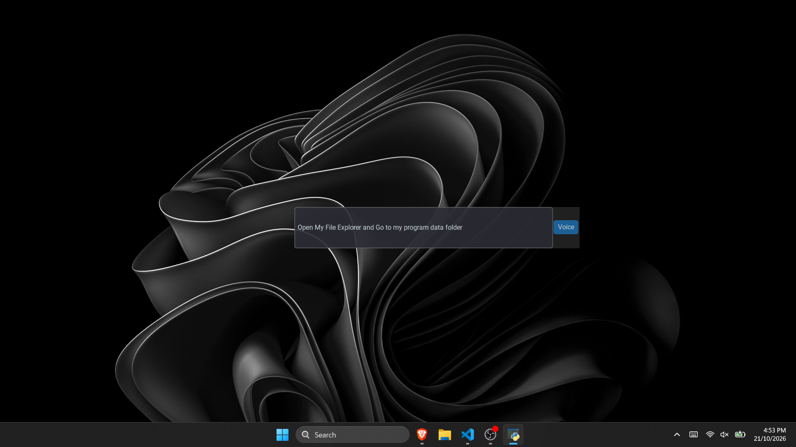

# JarVis (get it?)

This app is inspired by Iron Man's Jarvis Ai assistant but for your computer
It uses any AI API that can work with a custom endpoint on OpenAI

The AI sends commands Back to the the python script which will then perform those actions

IMPORTANT : EMERGENCY STOP -> ESC , will crash the whole program , use if the AI is doing something you dont want.

# Getting Started

## Dependencies 

* All required Dependencies are packaged in the exe

## Installing 

* Go to the releases page of the repo : https://github.com/DaynLalwani/JarVis/releases

* Download the newest Zip file
  
* Extract  it into your desired folder

## Executing the Program

* Run main.exe
* Click the Setup wizard button and follow the instructions

# NOTE
* Each output costs ~ 1000 tokens( 950 input and ~50 out) . make sure you can send at least 5-8 requests (50-80k) tokens , to make sure Jarvis can fulfill your command.

* Make sure you use a high Param Model as anything under ~128b params is not very smart
  
* CLICK ENTER TO START EXECUTION OF PROMPT

# Help

* IF JARVIS IS NOT WORKING , Re:Run The Setup WIZARD . 

* Backround service.py is exteremely buggy and may not work properly on certain machines , if you are having issues run main.py/main.exe

# Some Notable FREE Ai Platforms For you to connect JARVIS To

* Google Ai Studio ----> All Gemini Models
* Groq --> Many Models , ~200 actions / day
* Open Router --> Many free Models , sometimes unreliable

# VOICE RECOGNITION UPDATE 

Click Voice and OK to the message box . it will record your speech for the next 10 seconds .
After 10 seconds click OK to the next message box and it will automatically add the text to the input prompt( be aware depending on system resources it may take a while to convert your speech into text)

# Screenshot

# Video Tutorial On Setup

https://github.com/user-attachments/assets/084b3fa4-de5d-4ffa-96b3-c1f480ad738d

# Usage Tutorial

https://github.com/user-attachments/assets/56edd2ef-6cc4-419b-8a05-3641b4be0580

